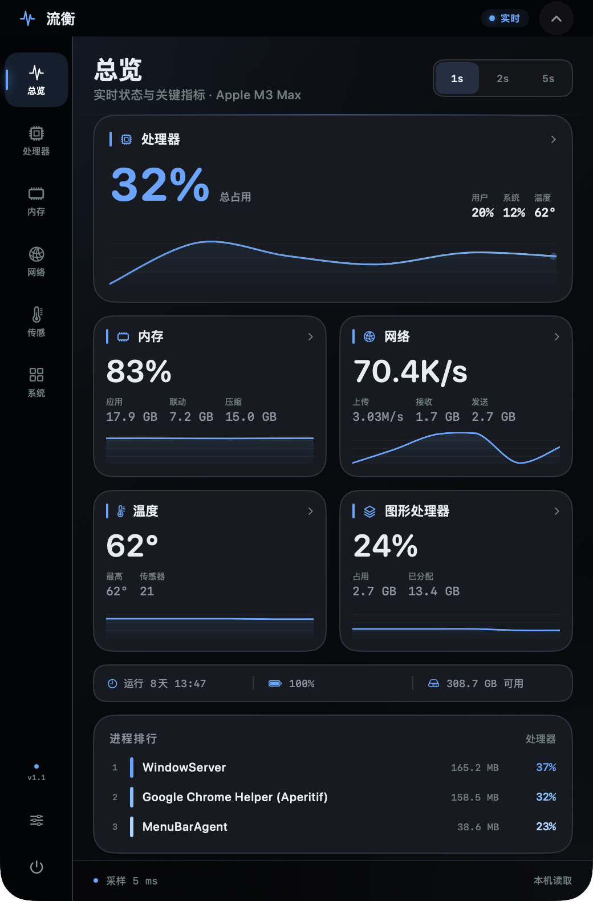

# Lumeth / 流衡

Lumeth is a native macOS system monitor that lives in the MacBook notch. The compact state stays at the menu-bar height and shows CPU, memory, network and temperature around the notch. Clicking it expands a live dashboard with processors, memory, network, sensors, disks, GPU, battery and processes.

The app is written in Swift and SwiftUI, with no third-party runtime dependencies.




## Features

- CPU per-core usage, user/system/idle split, load averages and top processes
- Memory composition, compressed memory, swap and pressure
- Network download/upload rates and totals
- GPU utilization and memory
- Disk throughput and capacity
- Battery level, cycles and health
- Temperature sensors via the root-free IOHID path
- 18 localizations; Chinese uses `zh-Hans` / `zh-Hant`
- Compact mode is 32 pt tall and flush with the notch
- Click outside, press `Esc`, or use the chevron to collapse

## Requirements

- macOS 14 Sonoma or later
- Xcode 15 or later for the Xcode target
- Apple Silicon or Intel; the Xcode archive builds universal

## Build

Swift Package Manager build:

```bash
./build.sh
open build/Lumeth.app
```

The script builds the release binary, compiles `Assets.xcassets`, copies all
`*.lproj` resources, and ad-hoc signs the result.

Xcode project:

```bash
xcodegen generate
open Lumeth.xcodeproj
```

`project.yml` is the source of truth for the Xcode project. Do not edit
`Lumeth.xcodeproj` by hand.

## Release

Publish a GitHub Release from a tag such as `v1.2.0`. The App Store workflow
derives the marketing version, builds and signs the package, uploads it to App
Store Connect, attaches the processed build and submits it for App Review.

## Signing

Developer ID distribution:

```bash
codesign --force --options runtime --timestamp \
  --sign 'Developer ID Application: chengjie li (SV2LZPC92A)' \
  build/Lumeth.app
```

The App Store target uses `Resources/Lumeth.entitlements` with App Sandbox
enabled. See [docs/APPSTORE.md](docs/APPSTORE.md) for the current submission
status and release operation details.

## Bundle identity

- Bundle ID: `com.sansi.lumeth`
- Team: `SV2LZPC92A`
- Minimum macOS: `14.0`
- Category: Utilities

## Local development data

All reads are local. Lumeth does not make network requests, upload analytics,
or install a privileged helper. Fan control is intentionally not included;
it requires a privileged SMC helper.

See [docs/PRIVACY.md](docs/PRIVACY.md).

Support: https://sansi-lcj.github.io/lumeth/support.html

## Project layout

```text
Sources/Pulse/        SwiftUI app, samplers and localization helper
Resources/            Info.plist, assets, entitlements and 18 .lproj folders
scripts/              localization and icon generators
project.yml           XcodeGen project definition
build.sh              SwiftPM app bundler
```

Lumeth is an independent project. It is not affiliated with Apple, iStat
Menus, Pulse, or any other monitoring product.
